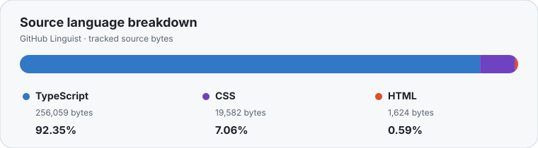

# ZOT

<p align="center">
<strong>Zero-Shot Prompt Routing System</strong><br />
Route prompts across local and hosted language models with visible task classification, configurable providers, request telemetry, and cost estimates.
</p>

<p align="center">
<a href="https://nameisvignesh.github.io/Zot/"></a>
<a href="https://github.com/nameisvignesh/Zot/actions/workflows/deploy.yml"></a>
<a href="LICENSE"></a>


</p>

<p align="center">
<a href="#quick-start">Quick start</a> · <a href="#configure-a-model">Configure a model</a> · <a href="#ollama-local-model">Ollama guide</a> · <a href="#deployment">Deployment</a>
</p>

## About

ZOT is a browser-based prompt routing workspace. It classifies a prompt, lets you choose a configured model, sends the request to that model, and records the result for review. Use Ollama on your own computer or connect a hosted provider with your own API key.

ZOT is a frontend application. Local use does not require a ZOT server or database. Model requests go directly from your browser to the endpoint you configure.

## Technology

| Area | Technology |
| --- | --- |
| UI | React 19, TypeScript 5.8 |
| Build and dev server | Vite 6 |
| Styling | Tailwind CSS 4 and project CSS |
| Charts and icons | Recharts, Lucide React |
| Browser persistence | Local storage |
| Local inference | Ollama HTTP API |
| Hosted inference | Provider APIs and Hugging Face Inference Providers |
| Static hosting | GitHub Pages, GitHub Actions |

### Language composition

The chart below uses the tracked source byte counts reported by GitHub Linguist.

<p align="center">

</p>

## Repository stars

<p align="center">

</p>

## Features

- Route a prompt to a selected model and classify common task types.
- Configure local Ollama models or compatible hosted APIs.
- Discover available models for providers that expose a model list.
- Refine prompts using local rules, a configured model, or Hugging Face.
- Review request tokens, measured latency, configured-price cost estimates, status, and errors.
- Browse analytics charts, a model connection map, and CSV export.
- Set a monthly cost alert and download Playground chats as Markdown.
- Keep model settings and telemetry in this browser.

## Quick start

Requirements: Node.js 20+, npm, and a modern browser. An inference provider is needed only to generate model responses.

```sh
git clone https://github.com/nameisvignesh/Zot.git
cd Zot
npm install
npm run dev
```

Open the local URL printed in your terminal. In ZOT, open **Models**, configure a model, then use **Prompt Router** or **Playground**. Create a production build using `npm run build`; preview it with `npm run preview`.

## Configure a model

1. Open **Models** and select **Add custom model** or choose a model template.
2. Choose **Local** for Ollama or **Using API** for a hosted service.
3. Enter the model name, ID, endpoint, context length, and API key where required.
4. Use **Find models** when available to see model IDs associated with that key.
5. Save the model, enable it, and use **Test connection** to verify a real response.
6. Select the configured model in **Prompt Router**, **Playground**, or **Refinement**.

A valid key does not guarantee access to every model. Model access, billing, region, endpoint, and inference permission depend on the provider. A successful model-list request does not prove inference access.

## Ollama local model

The recommended starter is [Liquid AI LFM2.5 2.6B on Ollama](https://ollama.com/LiquidAI/lfm2.5-2.6b). It is optional: installing ZOT does not download model weights. Ollama lists its `q4_K_M` quantized file at about 1.7 GB; model files are not the full amount of memory a running system needs.

1. Install Ollama from [ollama.com/download](https://ollama.com/download) and start it.
2. Download the model:
   ```sh
   ollama pull LiquidAI/lfm2.5-2.6b
   ```
3. Confirm the model is installed:
   ```sh
   ollama list
   ```
4. In ZOT **Models**, edit the local entry or add a local model.
5. Set connection type **Local**, provider **Ollama**, model ID `LiquidAI/lfm2.5-2.6b`, endpoint `http://localhost:11434/api/chat`, and context length to `4096` for a memory-constrained computer.
6. Save and select **Test connection**. Then select it in the Router, Playground, or Refinement.

Ollama normally serves its local API on port 11434. If the browser cannot connect, check that Ollama is running and that firewall or browser security settings allow the page to reach the local API.

### Choose a local model for your hardware

These are practical starting points, not hard minimums. Actual memory use also includes the operating system, Ollama, ZOT's browser, context/KV cache, and other applications. Keep extra RAM and VRAM free; model download size alone is not a safe hardware estimate.

| Computer available | Suggested choice | Graphics and memory notes |
| --- | --- | --- |
| 2-4 GB system RAM | Use a hosted API model; avoid a local 2.6B model | The 1.7 GB model file leaves too little room for the OS, browser, and inference context. |
| 8 GB system RAM | LFM2.5 2.6B, Q4_K_M | A discrete GPU is optional; CPU or integrated graphics can run it more slowly. Start with a short prompt and a 2K-4K context. |
| 16 GB system RAM | LFM2.5 2.6B or Qwen3.5 4B | Qwen3.5 4B files are about 3.3-4.0 GB; a supported GPU with about 8 GB VRAM is a useful target, while CPU-only is also possible. |
| 32 GB system RAM | Qwen3.5 9B | Qwen3.5 9B files are about 6.6-7.6 GB; target 12 GB or more VRAM for a comfortable GPU-resident setup. |
| 64 GB system RAM | Qwen3.5 27B | Qwen3.5 27B files are about 17-20 GB; target 24 GB or more VRAM, or use system/unified memory and expect slower generation. |

For a small or older computer, start with LFM2.5 2.6B or use a hosted API instead of waiting on a model that cannot fit. For larger local models, check the exact quantized file size before downloading. Ollama supports CPU inference and supported NVIDIA, AMD, Apple Metal, and Vulkan devices; GPU support depends on the operating system, card, and driver. See [Ollama hardware support](https://docs.ollama.com/gpu). The model file sizes above are from the [official Ollama LFM2.5 listing](https://ollama.com/LiquidAI/lfm2.5-2.6b) and [Qwen3.5 tags](https://ollama.com/library/qwen3.5/tags).

### Low-memory computers

Speed depends on model size and quantization, available memory, CPU/GPU, prompt length, and other running apps. ZOT allows local requests up to three minutes and sets a smaller Ollama context and batch size to reduce memory pressure. For timeouts, try a smaller quantized model, shorten the prompt, or close memory-heavy applications. Increasing a timeout cannot make an oversized model fit in memory.

## Providers

Templates include OpenAI, Google Gemini, Anthropic, DeepSeek, Perplexity, and Mistral. Other services work when their API is compatible with a supported chat or generation request and permits browser-origin calls.

Some providers block browser requests with CORS. Those providers need a trusted server-side proxy; this repository does not include one. Never enter an API key on a shared or untrusted device.

## Telemetry and accuracy

- Latency measures the model HTTP request duration. Responses are not streamed, so this is not streamed time-to-first-token.
- Token counts use provider usage fields when provided; otherwise ZOT uses a local tokenizer estimate.
- Cost uses the input/output prices configured for a model. It can differ from provider invoices, discounts, taxes, cached-token rates, and billing rules.
- Context is compared with the context length configured for that model; it is not a provider-reported billing measurement.
- Analytics stores requests from this browser only.

## Privacy and storage

Model settings, API keys, preferences, and request history are stored in this browser's local storage; they are not synchronized between browsers. There is no account service or central ZOT database. Clearing browser storage removes saved settings and records. Prompt content is sent to the selected provider and is subject to its privacy and retention terms.

## Deployment

A GitHub Actions workflow builds the site after a push to `main` and publishes the generated files to the `gh-pages` branch. For a fork, open **Settings → Pages** and select **Deploy from a branch**, then choose `gh-pages` and the root folder.

## Project structure

```text
src/components/       Screens and shared UI
src/context/          App state, request execution, browser persistence
src/data/             Model templates and defaults
src/lib/               Model clients, routing, catalog, token utilities
src/types.ts           Shared TypeScript types
.github/workflows/     GitHub Pages deployment
public/                Static assets
```

## Contributing

Issues and pull requests are welcome. Include reproduction steps, browser and provider details, and non-secret error text. Do not include API keys, access tokens, or private prompts.

## Support

If ZOT is useful to you, you can support development here:

<table align="center"><tr><td></td><td><strong>Buy me a coffee</strong><br />Scan the QR code to support ZOT's development.</td></tr></table>

## License

Distributed under the [MIT License](LICENSE).
