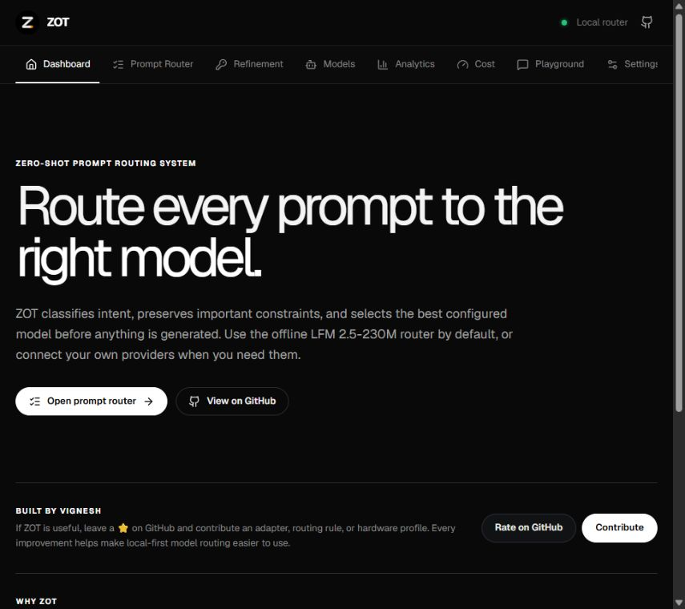

<div align="center">

# ZOT

### Zero-Shot Prompt Routing for a multi-model world

Classify a prompt, compare the models that can handle it, and send it to the model that best fits the task, budget, and latency you care about.

<p>
  <a href="https://github.com/nameisvignesh/Zot">Repository</a> ·
  <a href="https://github.com/nameisvignesh/Zot/issues">Issues</a> ·
  <a href="https://github.com/nameisvignesh/Zot/pulls">Contribute</a>
</p>



<p>
  
  
  
  
</p>

</div>

## What is ZOT?

ZOT is a local-first control plane for using multiple AI models. It separates the routing decision from generation so you can see why a model was selected and what that route is expected to cost before sending the request.

The interface is designed for a black-and-white workspace with small, meaningful status colors: green for healthy and successful states, red for errors, and yellow for warnings. It uses the bundled Geist Variable font and adapts to compact mobile layouts.

```text
Your prompt
    │
    ▼
Classify intent + estimate tokens
    │
    ▼
Compare configured and public models
    │
    ▼
Route to the selected provider
    │
    ▼
Chat response + latency + cost telemetry
```

## Features

- **Dashboard** — product overview, routing concepts, and quick access to the main workflows.
- **Prompt Router** — classify a prompt, choose a target override, and compare model context, token estimates, latency, and cost.
- **Model Registry** — configure API providers, test connections, use built-in model templates, and inspect the live public catalog.
- **Playground** — chat with a selected configured model, see routing decisions, and clear the conversation at any time.
- **Prompt Refinement** — use a Hugging Face token or a common provider token to unlock the refinement workflow and compare token savings.
- **Analytics** — inspect routing history, token usage, request outcomes, model usage, and chart/table views.
- **Cost meter** — set an INR, USD, EUR, or GBP alert threshold from 100 to 50,000, including a custom amount.
- **Settings** — configure language, currency, default model, local device, timeout, and routing behavior. Unsaved settings are protected when navigating away.
- **Internationalized UI** — English, Tamil, Hindi, Russian, German, Japanese, and Korean labels are available.
- **Responsive workspace** — navigation, tables, cards, and chat controls adapt to small screens.

## Quick start

### Requirements

- Node.js 20 or newer
- npm 10 or newer

### Install and run

```bash
git clone https://github.com/nameisvignesh/Zot.git
cd Zot
npm install
npm run dev
```

Open [http://localhost:3000](http://localhost:3000).

### Production build

```bash
npm run typecheck
npm run build
npm run preview
```

## Configure a model

1. Open **Models**.
2. Choose a built-in template or add a custom model.
3. Enter the provider API key, endpoint, and model ID.
4. Select **Test connection**.
5. Open **Playground** or **Prompt Router** and send a prompt.

ZOT accepts OpenAI-compatible endpoints and has native request handling for Anthropic and Google Gemini endpoints. Common endpoint bases include:

| Provider | Endpoint base |
| --- | --- |
| OpenAI | `https://api.openai.com/v1` |
| Anthropic | `https://api.anthropic.com` |
| Google Gemini | `https://generativelanguage.googleapis.com/v1beta` |
| OpenRouter | `https://openrouter.ai/api/v1` |

Provider keys are entered in the browser and are not part of the repository. Do not commit API keys or `.env` files.

## Public model catalog

The Models and Prompt Router pages load the public catalog from the [OpenRouter Models API](https://openrouter.ai/docs/api/api-reference/models/get-models) at runtime. Catalog entries include model name, provider, context length, published pricing, and documentation links. Prompt-specific token and estimated cost values are calculated by ZOT; latency is shown when the catalog publishes it.

## Local LFM checkpoint

ZOT can recognize the optional `LFM2.5-230M/` checkpoint directory as a local route target. The checkpoint is intentionally not committed because its weights are large and are maintained in the Liquid AI Hugging Face repository.

To download it locally when needed:

```bash
git lfs install
git clone https://huggingface.co/LiquidAI/LFM2.5-230M LFM2.5-230M
```

The browser app can use the checkpoint as a local routing target. Generated chat responses from local weights require a compatible local inference runtime; configured API providers can answer directly from the Playground.

## Project structure

```text
src/
├── components/       UI views for dashboard, routing, models, chat, analytics, and settings
├── context/          Shared settings, models, routing, telemetry, and persistence state
├── data/             Built-in model templates and initial application data
├── lib/              Routing engine, tokenizer, model client, i18n, and public catalog loader
├── types.ts           Shared TypeScript domain types
└── index.css          Geist Variable font, theme tokens, responsive layout, and components
public/
├── fonts/             Bundled Geist Variable WOFF2 font
└── readme-dashboard.png  Dashboard screenshot used in this README
```

## Development notes

- `npm run dev` starts Vite on port `3000`.
- `npm run typecheck` runs TypeScript without emitting files.
- `npm run build` creates the production bundle in `dist/`.
- Preferences, configured models, and local telemetry are kept in browser storage for this client-side workspace.
- The downloaded LFM checkpoint is ignored by Git; keep it outside commits and releases.

## Contributing

Issues and pull requests are welcome. For a focused change, include the affected screen, a short description of the behavior, and the validation command you ran.

1. Fork the repository.
2. Create a focused branch.
3. Run `npm run typecheck` and `npm run build`.
4. Open a pull request with screenshots for visual changes.

## License

ZOT is released under the [MIT License](LICENSE).
