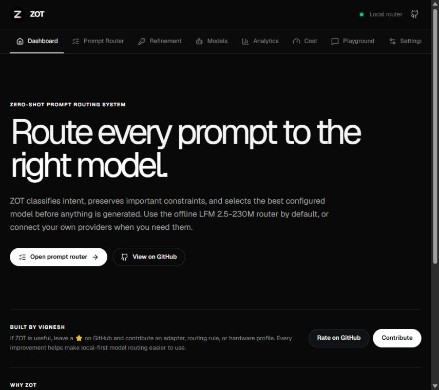
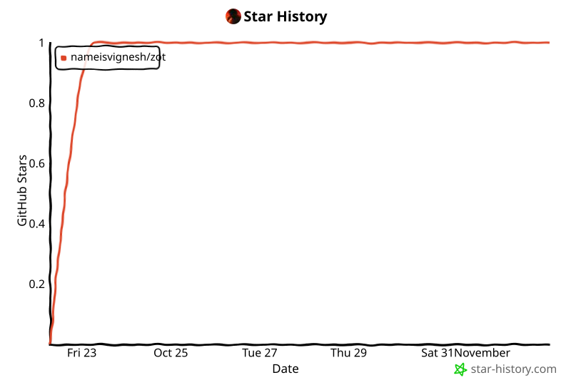

<div align="center">
  
  <h1>ZOT</h1>
  <p><strong>Zero-Shot Prompt Routing System</strong></p>
  <p>Route every prompt to the right model.</p>

  <a href="https://github.com/nameisvignesh/Zot"></a>
  <a href="https://github.com/nameisvignesh/Zot/blob/main/LICENSE"></a>
  <a href="https://nodejs.org/"></a>
  <a href="https://react.dev/"></a>
  <a href="https://www.typescriptlang.org/"></a>
  <a href="https://github.com/nameisvignesh/Zot/actions/workflows/deploy.yml"></a>

  <br />
  <br />

  <a href="#quick-start">Quick Start</a> •
  <a href="#how-it-works">How It Works</a> •
  <a href="#features">Features</a> •
  <a href="#configure-a-model">Configuration</a> •
  <a href="#troubleshooting">Troubleshooting</a> •
  <a href="#license">License</a>
</div>

<br />

<div align="center">
  <table>
    <tr>
      <td width="58%">
        
      </td>
      <td width="42%">
        
      </td>
    </tr>
  </table>
</div>

<br />

<div align="center">

ZOT is a browser-based workspace for routing prompts to local or hosted language models. Classify intent, refine prompts, choose a model automatically or directly, and review request and cost estimates.

</div>

> **Hosted model requests are sent directly from your browser.** Some providers block browser requests through CORS and require a trusted server-side proxy. ZOT does not include a proxy.

## Quick Start

### Requirements

- Node.js 20 or newer
- npm
- A modern browser
- Ollama or an API key for a compatible hosted model

### Install

```sh
git clone https://github.com/nameisvignesh/Zot.git
cd Zot
npm install
npm run dev
```

Open the address printed by Vite, then add and enable a model in **Models**.

## Features

- **Automatic routing** — classify a prompt and route it to an enabled model.
- **Model selection** — use automatic routing or explicitly select a configured model.
- **Prompt refinement** — reduce filler and repetition while protecting meaning and key constraints.
- **Model playground** — chat with configured local or hosted models.
- **Model catalog** — discover public model IDs, context windows, and published prices.
- **Usage insights** — inspect request history, estimated tokens, latency, and costs.
- **Budget controls** — monitor spending against a configurable monthly limit.
- **Browser-based storage** — keep model settings and request history in the current browser.

## How It Works

1. ZOT estimates prompt tokens and classifies the request.
2. The routing algorithm selects an enabled model from the current model pool, unless you explicitly select one.
3. If prompt refinement is requested, ZOT prepares the prompt before inference.
4. Your browser sends the request to the configured model endpoint.
5. ZOT displays the response and stores request metrics in browser storage.

Automatic routing considers task category, prompt complexity, model availability, context capacity, cost, and priority.

## Configure a Model

1. Open **Models** and select **Add custom model** or a provider template.
2. Select **Local** for an Ollama endpoint or **Using API** for a hosted provider.
3. Enter the model name, exact model ID, endpoint, and API key where required.
4. Select **Find models** if the provider supports model discovery.
5. Save and enable the model, then select **Test connection**.
6. Use **Auto route** or choose the model in Prompt Router, Playground, or Refinement.

For OpenAI-compatible providers, enter a full chat-completions URL or a compatible base URL. For a base URL ending in `/v1`, ZOT appends `/chat/completions`.

### Ollama

1. [Install Ollama](https://ollama.com/download) and start it.
2. Download a model:
   ```sh
   ollama pull LiquidAI/lfm2.5-2.6b
   ```
3. Add a model in ZOT with:
   - Provider: `Ollama`
   - Model ID: `LiquidAI/lfm2.5-2.6b`
   - Endpoint: `http://localhost:11434/api/chat`
4. Save the model and test the connection.

The browser must be able to reach the Ollama endpoint. A local checkpoint without an inference runtime endpoint cannot generate responses.

### NVIDIA NIM

Use your NIM API key and a model ID available to that key. Set the endpoint to:

```text
https://integrate.api.nvidia.com/v1
```

ZOT adds `/chat/completions` to the base URL. If NVIDIA NIM blocks browser-origin requests, use a trusted server-side proxy; do not disable browser security.

## Privacy and Security

- Model settings, provider API keys, preferences, and request history are stored in the current browser's local storage.
- ZOT does not synchronize this data between browsers or provide a hosted account database.
- Prompts are sent to the configured model provider. Review the provider's data handling and retention policies.
- Never commit API keys to frontend code or include them in issues, screenshots, or logs.
- GitHub Pages serves the frontend only; it cannot securely proxy provider requests.
- Token counts and costs may be estimates. Cost estimates use the prices configured in ZOT and may differ from provider billing.

## Troubleshooting

### The browser cannot reach a provider

Check the endpoint, network connection, provider status, and browser console. A `Failed to fetch` error may indicate a CORS restriction, not necessarily an invalid API key or model ID. The provider must allow the app's origin, or requests must go through a trusted server-side proxy.

### The model ID is rejected

Use the exact ID expected by the provider. A model appearing in a public catalog does not guarantee inference access. Check account permissions, region, availability, and billing.

### Ollama does not respond

Confirm Ollama is running, the model is downloaded, the configured ID is correct, and the browser and firewall permit connections to the local endpoint.

### A response is empty or incomplete

Check the error shown by ZOT and confirm that the model supports the configured endpoint and response format. Long prompts consume context and can leave less room for generated output.

## Development

```sh
npm install
npm run dev
```

Type-check and build the production bundle:

```sh
npm run lint
npm run build
```

Preview the production bundle locally:

```sh
npm run preview
```

The application uses React, TypeScript, and Vite.

```text
src/components/   Application pages and shared UI
src/context/      Application state and browser persistence
src/data/         Default models, settings, and sample data
src/lib/           Routing, model requests, catalog, and prompt utilities
src/types.ts       Shared TypeScript types
public/            Static assets and README images
.github/workflows/ CI and deployment workflows
```

## Deployment

The GitHub Actions workflow builds the app and publishes it to the `gh-pages` branch on pushes to `main` or `master`. For a fork, configure GitHub Pages to serve the root of `gh-pages`.

GitHub Pages hosts only the frontend. Keep provider keys out of source code and use a trusted backend if a provider requires a proxy.

## Contributing

Bug reports and pull requests are welcome. Include reproduction steps, browser and provider details, and non-secret error messages. Remove API keys, access tokens, and private prompts from reports.

### AI Assistance

AI tools used during development include ChatGPT (OpenAI) and Claude (Anthropic). Listing these tools does not add them to GitHub's Contributors panel.

## License

ZOT is distributed under the [MIT License](LICENSE).
